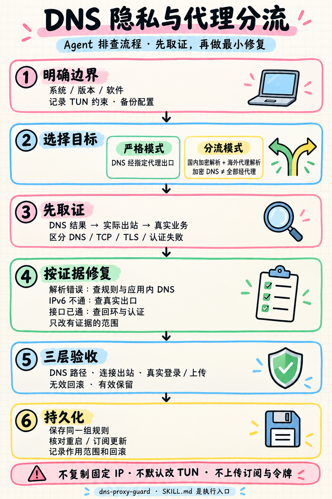

# DNS Proxy Guard

面向 Codex 和其他兼容 agent 的 DNS 隐私与代理分流排查 skill。把“解析走哪里”“业务走哪里”“软件是否恢复”分开验证，支持基于日志的局部修复、持久化和回滚。

**执行入口：[SKILL.md](SKILL.md)** · [流程文字版](references/agent-flow.md) · [持久化与复发排查](references/persistence.md) · [辅助脚本](references/helper-tools.md)

**具体规则：[微信、剪映、国内网页与浏览器的已验证配方](references/verified-rule-recipe.md)**（条件式案例，含业务规则和 DNS 配套；不是一键应用配置）。



## 它解决什么

- 分清全部 DNS 经代理与加密 DNS 分流，避免错误的“零泄露”结论。
- 检查系统、浏览器、应用内 DNS 和 Mihomo DNS 模块之间的实际路径。
- 排查国内软件直连、IPv6 不可达、fake-ip 兼容、回环和扫码登录等不同问题。
- 根据证据生成限定 IP/协议/端口的 IPv4 兼容例外，而不是复制某台电脑的地址。
- 保留用户指定的 TUN、节点及其他软件配置，验证真实业务再持久化。
- 排查同名订阅换 UID、空扩展和配置重新生成导致的修复丢失，验证全局与订阅扩展的最终组合。
- 对比同网址在不同浏览器的实际分流，避免全进程 DIRECT 误伤海外网页。

它不是 VPN 服务、节点订阅或一键匿名工具。DoH 不等于所有查询经代理；直连软件仍会向业务服务暴露本地出口 IP。网页 DNS 测试也不能覆盖电脑上的每一个应用。

## 安装与使用

将本仓库放入 agent 的 skill 目录，并保持目录名 `dns-proxy-guard`。Codex 的默认位置是 `~/.codex/skills/dns-proxy-guard`；设置了 `CODEX_HOME` 时，使用该目录下的 `skills`。

```sh
git clone https://github.com/mariozhaofan-pixel/dns-proxy-guard.git ~/.codex/skills/dns-proxy-guard
```

例如：

> 使用 $dns-proxy-guard 排查我的 DNS 路径和微信发图失败。国内软件应本地直连，其他流量保持现状，不改 TUN。先取证再修改，并说明 DNS 是否全部经代理。

> 使用 $dns-proxy-guard 审查这份候选 Mihomo 配置。只做离线检查，不连接控制器，不修改网络。

> 使用 $dns-proxy-guard 排查重新导入订阅后再次出现的 DNS 泄露。保留国内软件和浏览器分流，检查当前 UID、扩展绑定与配置生成顺序，修复后验证持久化。

没有 skill 自动发现机制的 agent，可以先读取 `SKILL.md`，再按其中链接按需加载参考资料。流程图用于速览；文字和代码才是精确执行依据。

## 脚本与适用范围

仓库中的 Python 脚本只读取本地输入、生成报告或 JavaScript 扩展；**不会自动应用配置或修改网络**。Python 3.10+；JSON 输入不需要第三方库，YAML 输入需要 PyYAML。生成的 JavaScript 面向 Mihomo 配置的 profile 扩展流程，应用前必须检查客户端版本与生成顺序。

```sh
python scripts/audit_mihomo.py /private/path/runtime.json
python scripts/audit_mihomo.py /private/path/verified.json --compare /private/path/regenerated.json --require-equivalent
python -m unittest discover -s tests -v
```

文档记录的具体实现依据包括 Mihomo v1.19.32、Clash Verge Rev v2.5.8；协议层排查可迁移到其他系统和客户端，但这些字段不能直接照搬给不同内核。脚本离线测试覆盖范围以 [辅助脚本说明](references/helper-tools.md) 为准。

2026-10-15 更新重点：订阅重新导入与配置回退取证、持久扩展的组合验证、冲突前置检查、脚本异常不会自动阻断网络的边界，以及浏览器对照与私有 NetLog 分析。新增严格配置等价检查，避免把“无关配置保留”误当成“持久化结果与已验收候选一致”。PNG 仍用于六步概览，新增分支见流程文字版。

2026-10-16 补充实际规则配方：八条应用/国内分流、十四项局部 DNS 例外、DIRECT 再解析继承和节点引导解析，以及微信 IPv4 出站与有限嗅探的联动条件。公开配方保留必要的公共软件/服务标识，隐藏个人订阅身份、节点、出口和故障地址；浏览器继续按域名分流，迁移时检查现有明确代理例外的优先级。

2026-10-15 验证：31 项离线测试通过，无跳过，包含 Node.js 与 PyYAML 实际执行；skill 结构检查和独立前向场景复审通过。测试覆盖严格等价、敏感字段不回显、冲突拒绝、幂等与原配置保全。初版另通过 Mihomo v1.19.32 合成配置校验；本次未改兼容例外生成器，未重新操作真实网络。这些离线/合成验证不代表使用者自己的网络已经验证。

## 隐私与贡献

不要上传订阅链接、节点凭据、controller secret、完整配置、Cookie、登录链接、聊天记录或原始抓包。反馈问题时提供脱敏后的版本、错误类别、规则类型和最小合成案例；原始备份留在自己的私有目录。

本仓库只包含通用方法、文档地址示例和离线辅助工具，没有发布原排查机器的账号、真实节点或固定故障 IP。参考图中的特定产品命令未经核验不会作为本 skill 的步骤。

许可证：[MIT](LICENSE)。流程图由内置图像生成工具制作，文字说明见 [图像制作说明](references/figure-notes.md)。
