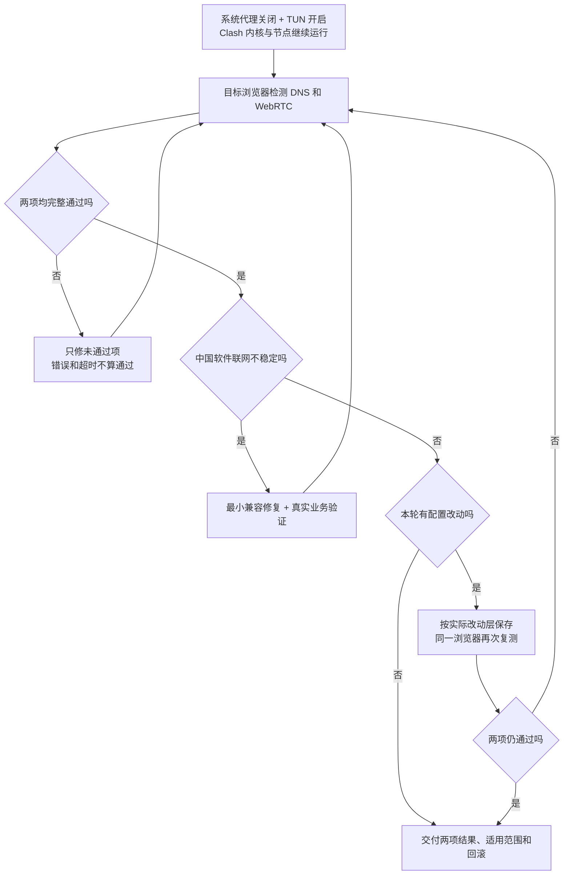

# DNS Proxy Guard

面向 Codex 和其他兼容 agent 的 DNS / WebRTC 防泄露 skill。默认开场引导用户关闭 Clash **系统代理**、开启 **TUN**，保持内核与节点运行，再以 [Net.Coffee Claude 检测页](https://ip.net.coffee/claude/) 的两项结果为最终目标：

- **DNS：未检测到泄露。**
- **WebRTC：已禁用或无泄露。**

必须在用户实际使用的浏览器完成本轮检测，并在持久化后复测；检测超时、错误或空结果不算通过。中国软件正常时不改应用路由，只有出现联网不稳定才进入兼容修复。

**执行入口：[SKILL.md](SKILL.md)** · [目标页验收](references/acceptance.md) · [WebRTC 排查](references/webrtc.md) · [完整流程图](references/agent-flow.md) · [持久化与复发排查](references/persistence.md)

**仅异常时使用：[微信、剪映、国内网页的兼容规则配方](references/verified-rule-recipe.md)**。这是条件分支，不是默认预置规则或一键应用配置。



## 它解决什么

- 区分关闭系统代理与停止 Clash，核实 TUN 接管后再检测。
- 分别定位 DNS 和浏览器 WebRTC，保护现有正常业务，避免靠拦截测试请求制造通过。
- 仅在中国软件异常时，按证据处理应用直连、IPv6、fake-ip、回环与认证问题。
- 排查订阅换 UID、扩展覆盖和配置重新生成导致的复发，并核对最终结果。
- 保存同一组有效变更，明确直连例外、测试覆盖和回滚方式。

它不是 VPN 服务、节点订阅或一键匿名工具。两项通过只描述当前浏览器、配置和检测时间；不代表所有应用永久无泄露。DoH 不等于经代理，直连业务仍使用本地出口。Claude 信任分数、住宅 IP 或“中国出口”卡片不替代这两项验收。

## 安装与使用

将本仓库放入 agent 的 skill 目录，并保持目录名 `dns-proxy-guard`。Codex 的默认位置是 `~/.codex/skills/dns-proxy-guard`；设置了 `CODEX_HOME` 时，使用该目录下的 `skills`。

```sh
git clone https://github.com/mariozhaofan-pixel/dns-proxy-guard.git ~/.codex/skills/dns-proxy-guard
```

例如：

> 使用 $dns-proxy-guard，先引导我关闭 Clash 系统代理并开启 TUN，在我常用的浏览器完成 Net.Coffee Claude 页检测，达到 DNS 无泄露和 WebRTC 已禁用或无泄露。中国软件出现联网问题时再修分流。

> 使用 $dns-proxy-guard 审查这份候选 Mihomo 配置。只做离线检查，不连接控制器，不修改网络。

> 使用 $dns-proxy-guard 排查重新导入订阅后两项检测再次失败的问题。国内软件正常，不预置应用例外；检查 UID、扩展绑定和持久化。

没有 skill 自动发现机制的 agent，可以先读取 `SKILL.md`，再按需加载参考资料。用户更具体的只读或 TUN 约束优先。当前流程使用上面的 Mermaid 和流程文字版；原 PNG 保留为历史素材，不再作为执行入口。

## 脚本与适用范围

仓库中的 Python 脚本只读取本地输入、生成报告或 JavaScript 扩展；**不会自动应用配置或修改网络**。Python 3.10+；JSON 输入不需要第三方库，YAML 输入需要 PyYAML。生成的 JavaScript 面向 Mihomo 配置的 profile 扩展流程，应用前必须检查客户端版本与生成顺序。

```sh
python scripts/audit_mihomo.py /private/path/runtime.json
python scripts/audit_mihomo.py /private/path/verified.json --compare /private/path/regenerated.json --require-equivalent
python -m unittest discover -s tests -v
```

文档记录的具体实现依据包括 Mihomo v1.19.32、Clash Verge Rev v2.5.8；协议层排查可迁移到其他系统和客户端，但这些字段不能直接照搬给不同内核。脚本离线测试覆盖范围以 [辅助脚本说明](references/helper-tools.md) 为准。

2026-10-28 调整默认工作流：系统代理关闭、TUN 开启 → 目标浏览器 DNS/WebRTC 双项检测 → 修复未通过项 → 仅在中国软件不稳定时进入兼容分支 → 持久化后双项复测。新增目标页验收与 WebRTC 参考，避免将其他浏览器、旧结果、脚本失败或空候选误当成功。

本轮结构、引用与元数据检查通过，并完成四个模拟场景的独立复审；未修改或检测用户真实网络。首次通过且无改动直接交付，浏览器单项改动不触发无关的代理生成链检查。

2026-10-15 增加订阅复发与配置回退排查、扩展组合验证、浏览器对照和严格配置等价检查；不能把“无关配置保留”误当成“持久化结果与已验收候选一致”。

2026-10-16 补充实际规则配方：八条应用/国内分流、十四项局部 DNS 例外、DIRECT 再解析继承和节点引导解析，以及微信 IPv4 出站与有限嗅探的联动条件。公开配方保留必要的公共软件/服务标识，隐藏个人订阅身份、节点、出口和故障地址；浏览器继续按域名分流，迁移时检查现有明确代理例外的优先级。

2026-10-15 验证：31 项离线测试通过，无跳过，包含 Node.js 与 PyYAML 实际执行；skill 结构检查和独立前向场景复审通过。测试覆盖严格等价、敏感字段不回显、冲突拒绝、幂等与原配置保全。初版另通过 Mihomo v1.19.32 合成配置校验；本次未改兼容例外生成器，未重新操作真实网络。这些离线/合成验证不代表使用者自己的网络已经验证。

## 隐私与贡献

不要上传订阅链接、节点凭据、controller secret、完整配置、Cookie、登录链接、聊天记录或原始抓包。反馈问题时提供脱敏后的版本、错误类别、规则类型和最小合成案例；原始备份留在自己的私有目录。

本仓库只包含通用方法、文档地址示例和离线辅助工具，没有发布原排查机器的账号、真实节点或固定故障 IP。参考图中的特定产品命令未经核验不会作为本 skill 的步骤。

许可证：[MIT](LICENSE)。当前图表为可维护的 Mermaid；旧版 PNG 的历史制作记录见 [图像说明](references/figure-notes.md)。
