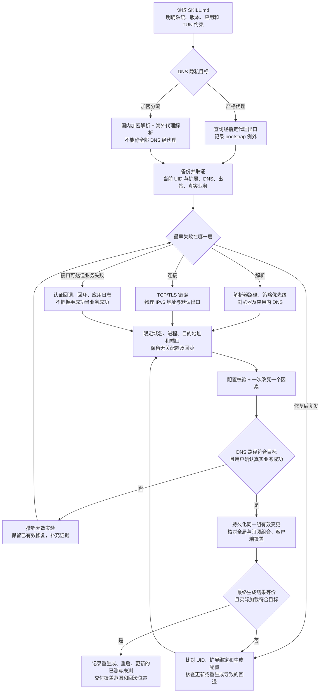

# Agent 流程图的精确文字版

对应 [流程图](../assets/agent-flow.png)。下面的 Mermaid 是可维护的流程源；图像文字与源文发生差异时，以 SKILL.md 和本文件为准。

## 关键判断

- TUN 接管与远端代理出站是两件事，读取实际命中规则和出站链。
- 加密 DNS 不等于经代理，不等于匿名。明文 53 检查不能覆盖 DoH。
- 没有可用原生 IPv6 出口时，DNS 配置不会创造出口。
- 字面 IPv6 无法仅靠 `ip-version: ipv4` 变成 IPv4。需先恢复真实域名，且协议可能无法嗅探。
- 嗅探按目标 IP/端口作用，进程规则仅限定路由；两者范围不同。
- 先验证真实登录/上传，再持久化；并发修改多个因素会让归因失真。
- 固定 IP 例外会老化。不要把一次成功当作所有网络、所有应用的通用保证。
- 同名订阅可能换了 UID；全局扩展也可能被后续层覆盖。脚本抛错不一定阻止客户端加载旧配置。
- 浏览器海外网站失败时先检查全进程 DIRECT；不要把浏览器和国内专用软件套入同一规则。

2026-10-15 补充了订阅复发与持久化分支。PNG 保留通用六步概览；新增分支的执行细节以本文件和 [持久化说明](persistence.md) 为准。
