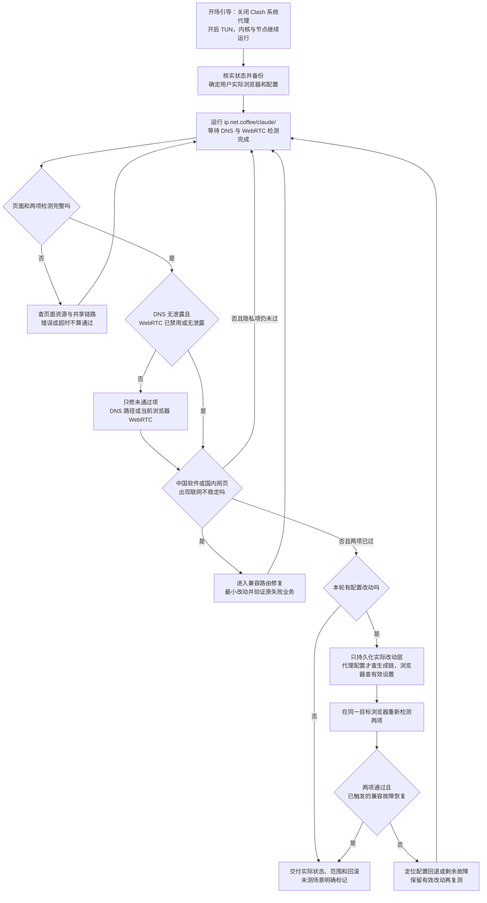

# DNS 与 WebRTC 主流程

2026-10-28 更新。以 [SKILL.md](../SKILL.md) 为执行入口；下图明确中国软件修复是条件分支。

- 关闭的是系统代理开关，不是 Clash 内核或节点；TUN 与规则/全局模式不同。
- 以目标浏览器的本轮两项结果验收，不能用内置浏览器替代，也不以信任评分验收。
- 正常的中国软件不改路由；条件分支完成后必须回主目标复测。
- 首次通过且无改动就直接交付；仅改浏览器时不重载无关的代理配置。
- 超时、错误或仅空结果不是无泄露；不拦截检测脚本/地址来刷绿灯。
- 国内加密直连例外不等于全部 DNS 经代理；页面结果不覆盖所有应用。
- 反复失败时补充证据并说明缺口，不盲目扩大 TUN、IPv6 或 UDP 改动。用户更具体的约束优先。

`assets/agent-flow.png` 是旧版通用 DNS 六步图，保留作历史素材，**不再作为当前流程入口**。当前流程与验收以本文件和 [目标页验收](acceptance.md) 为准。
